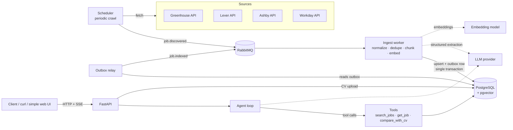

# Job Matcher — Architecture

Job Matcher ingests job postings from public career-site APIs, indexes them for hybrid
(semantic + full-text) search, and exposes an LLM agent that answers questions like
*"Which remote Python backend roles fit my CV, and what am I missing?"* — always citing
the concrete postings it used.

The goal of the project is to demonstrate production-style backend engineering around an
LLM: reliable async ingestion, a well-designed Postgres schema, retrieval that is measured
rather than guessed, and an agent loop with explicit tools and limits.

---

## 1. High-level overview



**Services** (each its own container, one shared Python package):

| Service | Responsibility |
|---|---|
| `api` | FastAPI app: CV upload, search endpoint, chat endpoint (SSE streaming), health. |
| `scheduler` | Periodically lists postings from configured sources and publishes `job.discovered` messages. Cheap and stateless. |
| `worker` | Consumes `job.discovered`; fetches detail, normalizes, deduplicates, chunks, embeds, upserts. |
| `outbox-relay` | Publishes `job.indexed` / `job.closed` events from the outbox table (same pattern as at work). |
| `postgres` | System of record, vector index (pgvector) and full-text index (tsvector). |
| `rabbitmq` | Work queue between scheduler and workers, with retry + dead-letter queues. |

---

## 2. Data sources

Only **public, documented JSON endpoints** that companies publish for their own job
boards — no HTML scraping, no logged-in sessions:

| Source | Endpoint | Notes |
|---|---|---|
| Greenhouse | `boards-api.greenhouse.io/v1/boards/{company}/jobs?content=true` | Full description in one call. |
| Lever | `api.lever.co/v0/postings/{company}?mode=json` | |
| Ashby | `api.ashbyhq.com/posting-api/job-board/{company}` | |
| Workday | `POST {tenant}.wd{n}.myworkdayjobs.com/wday/cxs/{tenant}/{site}/jobs` | Detail needs a second call. |

The list of companies lives in `sources.yaml` (company slug, ATS type, optional location
filter). Each source is a small adapter implementing one protocol:

```python
class SourceAdapter(ABC):
    kind: str
    def list_postings(self) -> AsyncIterator[RawPosting]: ...
```

Greenhouse, Lever and Ashby return full descriptions in the listing call, so the scheduler
publishes complete postings and the worker never calls the source. A Workday adapter would
fetch details in `list_postings` the same way.

Crawling is polite: a bounded connection pool per crawl and one request per company per run.

---

## 3. Ingestion pipeline

```mermaid
sequenceDiagram
    participant S as Scheduler
    participant Q as RabbitMQ
    participant W as Worker
    participant DB as Postgres
    participant R as Outbox relay

    S->>Q: job.discovered {full posting}
    Q->>W: deliver (prefetch=N)
    W->>W: html → text, compute content_hash
    alt hash unchanged
        W->>DB: touch last_seen_at
    else new or changed
        W->>W: extract structured fields (LLM, Pydantic schema)
        W->>W: chunk + embed
        W->>DB: BEGIN; upsert job, replace chunks, insert outbox row; COMMIT
    end
    W->>Q: ack
    R->>DB: SELECT ... FOR UPDATE SKIP LOCKED
    R->>Q: job.indexed
    R->>DB: mark published
```

Key decisions:

- **Idempotency.** Jobs are keyed by `(source, external_id)`; a `content_hash` of the
  normalized description decides whether re-embedding is needed. Redelivered messages are
  harmless.
- **Structured extraction.** The LLM fills a Pydantic model
  (`seniority`, `years_required_min`, `remote_policy`, `office_city`, `salary_min/max`,
  `currency`, `contract_type`, `tech_stack[]`, `required_skills[]`, `nice_to_have_skills[]`,
  `languages_required[]`). Output is validated;
  on validation failure the extractor retries once with the error message, then falls back
  to a heuristic extractor (also used when no API key is configured) instead of blocking
  the pipeline.
  These fields are what make filters like *"no Prague hybrid, ≤ 3 years required"* reliable —
  the exact filtering done by hand during the job search.
- **Chunking.** Postings are split by section (about / responsibilities / requirements /
  benefits, nice to have), max ~350 words, with the title and company prepended to each
  chunk. The section label is stored and used by `compare_with_cv`.
- **Retries and DLQ.** On failure the worker republishes the message to
  `job.discovered.retry.{n}` — one queue per delay (30 s, 5 min, 30 min) with a queue-level
  TTL that dead-letters back to `job.discovered` — tracking the attempt in an `x-attempt`
  header; after 3 attempts → `job.discovered.dlq`. One queue per delay avoids the
  head-of-line blocking of per-message TTLs. The original is acked only after the republish
  succeeded.
- **Closed postings.** After a complete, successful listing of a source, open postings
  missing from it are marked
  `status='closed'` (and a `job.closed` event is emitted) — never deleted, so history and
  evaluation sets stay stable.
- **Outbox.** Downstream events are written in the same transaction as the job row and
  published by a relay (`FOR UPDATE SKIP LOCKED`, at-least-once). Same pattern used in
  production at work; here it feeds a future "new matching job" notifier.

---

## 4. Data model (PostgreSQL 16 + pgvector)

```sql
CREATE TABLE source (
    id          smallserial PRIMARY KEY,
    kind        text NOT NULL,              -- greenhouse | lever | ashby | workday
    company     text NOT NULL,
    config      jsonb NOT NULL DEFAULT '{}',
    UNIQUE (kind, company)
);

CREATE TABLE job (
    id                  bigserial PRIMARY KEY,
    source_id           smallint NOT NULL REFERENCES source(id),
    external_id         text NOT NULL,
    url                 text NOT NULL,
    title               text NOT NULL,
    company             text NOT NULL,
    location_raw        text,
    description         text NOT NULL,
    content_hash        bytea NOT NULL,
    -- extracted, nullable when unknown
    seniority           text,               -- junior | medior | senior | staff
    years_required_min  smallint,
    remote_policy       text,               -- onsite | hybrid | remote_country | remote_region | remote_global
    office_city         text,
    salary_min          integer,
    salary_max          integer,
    currency            char(3),
    contract_type       text,               -- employment | contract | freelance
    tech_stack          text[] NOT NULL DEFAULT '{}',
    required_skills     text[] NOT NULL DEFAULT '{}',   -- migration 0003
    nice_to_have_skills text[] NOT NULL DEFAULT '{}',
    extraction_status   text NOT NULL DEFAULT 'pending',
    status              text NOT NULL DEFAULT 'open',   -- open | closed
    first_seen_at       timestamptz NOT NULL DEFAULT now(),
    last_seen_at        timestamptz NOT NULL DEFAULT now(),
    UNIQUE (source_id, external_id)
);
CREATE INDEX job_open_filters ON job (remote_policy, seniority, years_required_min) WHERE status = 'open';
CREATE INDEX job_tech_stack ON job USING gin (tech_stack);

CREATE TABLE job_chunk (
    id          bigserial PRIMARY KEY,
    job_id      bigint NOT NULL REFERENCES job(id) ON DELETE CASCADE,
    ord         smallint NOT NULL,
    section     text,
    content     text NOT NULL,
    embedding   vector(384) NOT NULL,
    tsv         tsvector GENERATED ALWAYS AS (to_tsvector('simple', content)) STORED
);
CREATE INDEX job_chunk_embedding ON job_chunk USING hnsw (embedding vector_cosine_ops);
CREATE INDEX job_chunk_tsv ON job_chunk USING gin (tsv);

CREATE TABLE cv (
    id          uuid PRIMARY KEY DEFAULT gen_random_uuid(),
    raw_text    text NOT NULL,
    profile     jsonb NOT NULL,             -- extracted: years, skills, languages, location prefs
    embedding   vector(384) NOT NULL,
    created_at  timestamptz NOT NULL DEFAULT now()
);

CREATE TABLE outbox (
    id           bigserial PRIMARY KEY,
    topic        text NOT NULL,
    payload      jsonb NOT NULL,
    created_at   timestamptz NOT NULL DEFAULT now(),
    published_at timestamptz
);
CREATE INDEX outbox_unpublished ON outbox (id) WHERE published_at IS NULL;
```

Migrations are managed with **Alembic**; the schema above is the target of the first
revision. `'simple'` text-search config is used because postings mix Czech and English.

---

## 5. Retrieval

`search_jobs` uses **hybrid search** with Reciprocal Rank Fusion, done in one SQL query:

1. **Hard filters** first (from the structured fields): `status='open'`, remote policy,
   city, max years required, seniority, contract type.
2. **Vector search**: top 50 chunks by cosine distance to the query embedding.
3. **Full-text search**: top 50 chunks by `ts_rank` against `websearch_to_tsquery`.
4. **Fusion**: `score = Σ 1 / (60 + rank)` across both lists, grouped per job (best chunk
   wins), top *k* jobs returned with the matching chunk as the citation snippet.

Why hybrid: embeddings catch synonyms ("backend developer" ≈ "Python vývojář"), full-text
catches exact tokens embeddings blur (`RabbitMQ`, `TimescaleDB`, `Databricks`).

**Embedding model:** `multilingual-e5-small` (384 dims) running locally in the worker
container — free, handles Czech and English, no data leaves the machine. The embedding
provider is behind an interface, so a hosted model can be swapped in. The large variant (1024 dims) was
tried first, but two copies of it (api + worker) next to a local 7B LLM exhausted 16 GB of
RAM; the small model keeps the whole stack runnable on a laptop (migration `0002`).

---

## 6. Agent

A plain tool-calling loop on top of the provider SDK — no agent framework, so every step
is visible and testable.

**Tools** (JSON-schema'd, implemented as regular async functions):

| Tool | Input | Output |
|---|---|---|
| `search_jobs` | `query`, optional filters (`remote_policy`, `city`, `max_years`, `seniority`, `contract_type`), `k` | ranked jobs with id, title, company, location, snippet, url |
| `get_job` | `job_id` | full normalized posting + extracted fields |
| `compare_with_cv` | `job_id`, `cv_id` | structured gap analysis: matched skills, missing must-haves, missing nice-to-haves, years gap, location fit |

**Loop rules:**
- System prompt states the user's CV profile summary and that every recommended job must
  come from a tool result and be cited by URL.
- Max 6 tool-call rounds per question, max 3 parallel tool calls per round; then the
  model must answer with what it has.
- Tool errors are returned to the model as structured `is_error` results, not raised.
- Agent events (tool calls, tool results, final answer) are streamed to the client over
  **SSE**, so the UI can show "searching remote Python roles…" while the agent works.
- Token usage and latency per request are logged.

`compare_with_cv` is deterministic first (set overlap of normalized skills, years and
location rules), and only asks the LLM to phrase the explanation — so the important part
is unit-testable.

---

## 7. API

| Method | Path | Purpose |
|---|---|---|
| `POST` | `/cv` | Upload CV (PDF or text) → extracted profile, returns `cv_id` |
| `GET` | `/jobs/search` | Direct hybrid search with filters (no LLM) |
| `GET` | `/jobs/{id}` | Job detail |
| `POST` | `/chat` | `{cv_id, message, history}` → SSE stream of tool events + answer |
| `GET` | `/healthz`, `/readyz` | Liveness / readiness (DB + broker reachable) |

Request/response models are Pydantic v2; OpenAPI docs come for free from FastAPI.

---

## 8. Evaluation

Retrieval quality is measured, not eyeballed:

- `eval/golden.yaml`: 15 questions (to grow to ~30), each with the set of job ids that a human marked as
  relevant, e.g. *"remote Python backend, max 3 years, no relocation"*.
- `eval/run_retrieval.py` computes **hit@5**, **recall@10** and **MRR** for
  (a) vector only, (b) full-text only, (c) hybrid — so the README can show *why* hybrid
  was chosen, with numbers.
- Answer faithfulness is checked on every chat turn: URLs in the final answer that no tool
  returned are reported as `unverified_urls` in the answer event.
- Evaluation runs against a frozen fixture snapshot of postings (`eval/fixtures/*.json`)
  so results are reproducible and CI does not depend on live job boards.

---

## 9. Testing

- **Unit:** source adapters (recorded JSON fixtures), normalization, chunking, RRF fusion,
  `compare_with_cv` rules, extraction schema validation.
- **Integration:** pytest against real Postgres + pgvector and RabbitMQ (CI service
  containers, same approach as the BubuTracker Go CI); LLM and embeddings replaced by
  deterministic fakes.
- **Contract:** the agent loop tested with a scripted fake model that issues predefined
  tool calls — verifies limits, error handling and citations without network.

---

## 10. Repository layout

```
JobMatcher/
├── ARCHITECTURE.md
├── README.md
├── docker-compose.yml
├── pyproject.toml              # uv, ruff, mypy, pytest
├── alembic/                    # migrations
├── sources.yaml
├── src/jobmatcher/
│   ├── config.py               # pydantic-settings
│   ├── llm.py                  # provider wrapper (Anthropic)
│   ├── messaging.py            # RabbitMQ topology
│   ├── db/                     # SQLAlchemy models, session, repositories
│   ├── sources/                # base.py, greenhouse.py, lever.py, ashby.py
│   ├── ingest/                 # scheduler, worker, indexer, normalize, chunking, extraction
│   ├── outbox/relay.py
│   ├── search/                 # embeddings.py, hybrid.py, metrics.py
│   ├── agent/                  # loop.py, tools.py, prompts.py
│   ├── cv/                     # profile.py (extraction + comparison)
│   └── api/                    # main.py, deps.py, routes/, schemas.py
├── eval/
│   ├── golden.yaml
│   ├── fixtures/
│   └── run_retrieval.py
└── tests/
    ├── unit/
    └── integration/
```

---

## 11. Configuration and secrets

All configuration via environment variables loaded by `pydantic-settings`
(`DATABASE_URL`, `AMQP_URL`, `LLM_PROVIDER`, `LLM_BASE_URL`, `LLM_MODEL`, `LLM_API_KEY`,
`EMBEDDING_MODEL`, crawl intervals). The default LLM is a local Ollama model, so the project
runs without any paid API.
`.env.example` is committed; `.env` is git-ignored. No keys in code or in the image.

---

## 12. Deployment

**Phase 1 — local:** `docker compose up` brings up postgres (pgvector image), rabbitmq
(management plugin), a one-shot migration, api, worker, scheduler, outbox-relay.
`eval/run_retrieval.py` loads the eval fixtures, so the app is usable without crawling.

**Phase 2 — cloud via Terraform** (separate milestone, `infra/`):
- GCP Cloud Run for `api` and `worker`, Cloud Scheduler triggering the crawl,
  Cloud SQL for PostgreSQL (pgvector supported), Secret Manager for the API key.
- RabbitMQ in cloud: CloudAMQP free tier, keeping the same code path.
- GitHub Actions: `terraform plan` on PR, `apply` on merge to main; app images pushed to
  Artifact Registry.

---

## 13. Milestones

| # | Milestone | Done when |
|---|---|---|
| M1 | Skeleton | compose up, Alembic migration, `/healthz`, CI with lint + tests |
| M2 | Ingestion | Greenhouse + Lever adapters, worker with dedupe, retries, DLQ; jobs visible in DB |
| M3 | Search | embeddings, hybrid search, `/jobs/search` with filters; retrieval eval numbers in README |
| M4 | Agent | tools + loop + `/chat` SSE; CV upload and `compare_with_cv` |
| M5 | Polish | Ashby + Workday adapters, outbox relay, minimal web UI, architecture diagram in README |
| M6 | Cloud | Terraform deployment to GCP with CI/CD |

---

## 14. Decisions and trade-offs

| Decision | Alternatives considered | Why |
|---|---|---|
| Postgres + pgvector | Qdrant, Weaviate | One database for relational filters, full-text and vectors; filtering + fusion in one query; fewer moving parts. |
| RabbitMQ for ingestion | Celery, plain asyncio tasks | Explicit queues, DLQ and retry topology; matches production experience; async consumer via `aio-pika`. |
| No agent framework | LangChain, LangGraph | The loop is ~150 lines; full control over limits, errors and streaming; easier to test. |
| Local multilingual embeddings | Hosted embedding API | Free, offline, good Czech support; swappable behind an interface. |
| LLM structured extraction at ingest | Regex/heuristics | Years required, remote policy and seniority are written in free text in dozens of styles; extraction once at ingest makes filtering cheap at query time. |
| Outbox for events | Publish directly after commit | No lost or phantom events if the process dies between commit and publish. |
