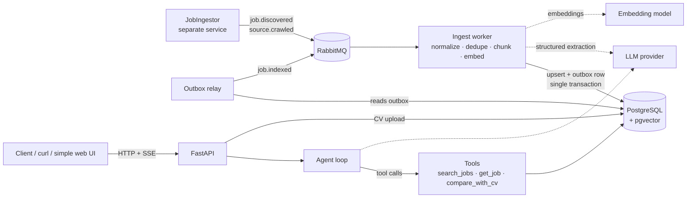

# Job Matcher — Architecture

Job Matcher indexes job postings crawled by the separate JobIngestor service for hybrid
(semantic + full-text) search, and exposes an LLM agent that answers questions like
*"Which remote Python backend roles fit my CV, and what am I missing?"* — always citing
the concrete postings it used.

The goal of the project is to demonstrate production-style backend engineering around an
LLM: reliable async ingestion, a well-designed Postgres schema, retrieval that is measured
rather than guessed, and an agent loop with explicit tools and limits.

---

## 1. High-level overview



**Services** (each its own container, one shared Python package):

| Service | Responsibility |
|---|---|
| `api` | FastAPI app: CV upload, search endpoint, chat endpoint (SSE streaming), health. |
| `worker` (listing sync) | Consumes `source.crawled`: reopens listed jobs and closes missing ones only when the listing was complete. |
| `worker` | Consumes `job.discovered`; fetches detail, normalizes, deduplicates, chunks, embeds, upserts. |
| `outbox-relay` | Publishes `job.indexed` / `job.closed` events from the outbox table (same pattern as at work). |
| `postgres` | System of record, vector index (pgvector) and full-text index (tsvector). |
| `rabbitmq` | Work queue between JobIngestor and the worker, with retry + dead-letter queues. |

---

## 2. Data sources

Crawling lives in JobIngestor (source registry, planner, crawlers for Greenhouse, Lever,
Ashby, Workday, Jobs.cz and others). It publishes two events to the shared `jobs` exchange:

| Routing key | Body | Consumer here |
|---|---|---|
| `job.discovered` | `RawPosting` (`jobmatcher.domain`): kind, company, source, external_id, url, title, location, description_html | worker → indexer |
| `source.crawled` | kind, source, external_ids, complete | worker → listing sync (reopen / close) |

JobMatcher used to carry its own adapters and a scheduler; they were removed so that one
service owns crawling and the message contract above is the only coupling.

---

## 3. Ingestion pipeline

```mermaid
sequenceDiagram
    participant S as JobIngestor
    participant Q as RabbitMQ
    participant W as Worker
    participant DB as Postgres
    participant R as Outbox relay

    S->>Q: job.discovered {full posting}
    Q->>W: deliver (prefetch=N)
    W->>W: html → text, compute content_hash
    alt hash unchanged
        W->>DB: touch last_seen_at
    else new or changed
        W->>W: extract structured fields (LLM, Pydantic schema)
        W->>W: chunk + embed
        W->>DB: BEGIN; upsert job, replace chunks, insert outbox row; COMMIT
    end
    W->>Q: ack
    R->>DB: SELECT ... FOR UPDATE SKIP LOCKED
    R->>Q: job.indexed
    R->>DB: mark published
```

Key decisions:

- **Idempotency.** Jobs are keyed by `(source, external_id)`; a `content_hash` of the
  normalized description decides whether re-embedding is needed. Redelivered messages are
  harmless.
- **Structured extraction.** The LLM fills a Pydantic model
  (`seniority`, `years_required_min`, `remote_policy`, `office_city`, `salary_min/max`,
  `currency`, `contract_type`, `tech_stack[]`, `required_skills[]`, `nice_to_have_skills[]`,
  `languages_required[]`). Output is validated;
  on validation failure the extractor retries once with the error message, then falls back
  to a heuristic extractor (also used when no API key is configured) instead of blocking
  the pipeline.
  These fields are what make filters like *"no Prague hybrid, ≤ 3 years required"* reliable —
  the exact filtering done by hand during the job search.
- **Chunking.** Postings are split by section (about / responsibilities / requirements /
  benefits, nice to have), max ~350 words, with the title and company prepended to each
  chunk. The section label is stored and used by `compare_with_cv`.
- **Retries and DLQ.** On failure the worker republishes the message to
  `job.discovered.retry.{n}` — one queue per delay (30 s, 5 min, 30 min) with a queue-level
  TTL that dead-letters back to `job.discovered` — tracking the attempt in an `x-attempt`
  header; after 3 attempts → `job.discovered.dlq`. One queue per delay avoids the
  head-of-line blocking of per-message TTLs. The original is acked only after the republish
  succeeded.
- **Closed postings.** After a complete, successful listing of a source, open postings
  missing from it are marked
  `status='closed'` (and a `job.closed` event is emitted) — never deleted, so history and
  evaluation sets stay stable.
- **Outbox.** Downstream events are written in the same transaction as the job row and
  published by a relay (`FOR UPDATE SKIP LOCKED`, at-least-once). Same pattern used in
  production at work; here it feeds a future "new matching job" notifier.

---

## 4. Data model (PostgreSQL 16 + pgvector)

```sql
CREATE TABLE source (
    id          smallserial PRIMARY KEY,
    kind        text NOT NULL,              -- greenhouse | lever | ashby | workday
    company     text NOT NULL,
    config      jsonb NOT NULL DEFAULT '{}',
    UNIQUE (kind, company)
);

CREATE TABLE job (
    id                  bigserial PRIMARY KEY,
    source_id           smallint NOT NULL REFERENCES source(id),
    external_id         text NOT NULL,
    url                 text NOT NULL,
    title               text NOT NULL,
    company             text NOT NULL,
    location_raw        text,
    description         text NOT NULL,
    content_hash        bytea NOT NULL,
    -- extracted, nullable when unknown
    seniority           text,               -- junior | medior | senior | staff
    years_required_min  smallint,
    remote_policy       text,               -- onsite | hybrid | remote_country | remote_region | remote_global
    office_city         text,
    salary_min          integer,
    salary_max          integer,
    currency            char(3),
    contract_type       text,               -- employment | contract | freelance
    tech_stack          text[] NOT NULL DEFAULT '{}',
    required_skills     text[] NOT NULL DEFAULT '{}',   -- migration 0003
    nice_to_have_skills text[] NOT NULL DEFAULT '{}',
    extraction_status   text NOT NULL DEFAULT 'pending',
    status              text NOT NULL DEFAULT 'open',   -- open | closed
    first_seen_at       timestamptz NOT NULL DEFAULT now(),
    last_seen_at        timestamptz NOT NULL DEFAULT now(),
    UNIQUE (source_id, external_id)
);
CREATE INDEX job_open_filters ON job (remote_policy, seniority, years_required_min) WHERE status = 'open';
CREATE INDEX job_tech_stack ON job USING gin (tech_stack);

CREATE TABLE job_chunk (
    id          bigserial PRIMARY KEY,
    job_id      bigint NOT NULL REFERENCES job(id) ON DELETE CASCADE,
    ord         smallint NOT NULL,
    section     text,
    content     text NOT NULL,
    embedding   vector(384) NOT NULL,
    tsv         tsvector GENERATED ALWAYS AS (to_tsvector('simple', content)) STORED
);
CREATE INDEX job_chunk_embedding ON job_chunk USING hnsw (embedding vector_cosine_ops);
CREATE INDEX job_chunk_tsv ON job_chunk USING gin (tsv);

CREATE TABLE cv (
    id          uuid PRIMARY KEY DEFAULT gen_random_uuid(),
    raw_text    text NOT NULL,
    profile     jsonb NOT NULL,             -- extracted: years, skills, languages, location prefs
    embedding   vector(384) NOT NULL,
    created_at  timestamptz NOT NULL DEFAULT now()
);

CREATE TABLE outbox (
    id           bigserial PRIMARY KEY,
    topic        text NOT NULL,
    payload      jsonb NOT NULL,
    created_at   timestamptz NOT NULL DEFAULT now(),
    published_at timestamptz
);
CREATE INDEX outbox_unpublished ON outbox (id) WHERE published_at IS NULL;
```

Migrations are managed with **Alembic**; the schema above is the target of the first
revision. `'simple'` text-search config is used because postings mix Czech and English.

---

## 5. Retrieval

`search_jobs` uses **hybrid search** with Reciprocal Rank Fusion, done in one SQL query:

1. **Hard filters** first (from the structured fields): `status='open'`, remote policy,
   city, max years required, seniority, contract type.
2. **Vector search**: top 50 chunks by cosine distance to the query embedding.
3. **Full-text search**: top 50 chunks by `ts_rank` against `websearch_to_tsquery`.
4. **Fusion**: `score = Σ 1 / (60 + rank)` across both lists, grouped per job (best chunk
   wins), top *k* jobs returned with the matching chunk as the citation snippet.

Why hybrid: embeddings catch synonyms ("backend developer" ≈ "Python vývojář"), full-text
catches exact tokens embeddings blur (`RabbitMQ`, `TimescaleDB`, `Databricks`).

**Embedding model:** `multilingual-e5-small` (384 dims) running locally in the worker
container — free, handles Czech and English, no data leaves the machine. The embedding
provider is behind an interface, so a hosted model can be swapped in. The large variant (1024 dims) was
tried first, but two copies of it (api + worker) next to a local 7B LLM exhausted 16 GB of
RAM; the small model keeps the whole stack runnable on a laptop (migration `0002`).

---

## 6. Agent

A plain tool-calling loop on top of the provider SDK — no agent framework, so every step
is visible and testable.

**Tools** (JSON-schema'd, implemented as regular async functions):

| Tool | Input | Output |
|---|---|---|
| `search_jobs` | `query`, optional filters (`remote_policy`, `city`, `max_years`, `seniority`, `contract_type`), `k` | ranked jobs with id, title, company, location, snippet, url |
| `get_job` | `job_id` | full normalized posting + extracted fields |
| `compare_with_cv` | `job_id`, `cv_id` | structured gap analysis: matched skills, missing must-haves, missing nice-to-haves, years gap, location fit |

**Loop rules:**
- System prompt states the user's CV profile summary and that every recommended job must
  come from a tool result and be cited by URL.
- Max 4 tool-call rounds per question (`MAX_ROUNDS`), then a fifth call with tools disabled,
  so the model must answer with what it has. At most 3 tool calls per round
  (`MAX_CALLS_PER_ROUND`); they run one after another because they share the request's DB
  session, and extra calls get an error result.
- Tool errors are returned to the model as structured `is_error` results, not raised.
- Posting text is scraped from the web, so tool results are untrusted input. Each result
  reaches the model inside `<untrusted_data>`, with chat-template control tokens
  (`<|im_start|>`, `[INST]`, …) and tool-protocol tags removed, because Ollama tokenizes those
  as real turn boundaries even inside message content. Links in posting text become `[link]`;
  only the jobs' `url` fields keep theirs, the links the agent may cite. The system prompt does
  not mention the envelope: a rule saying so was measured and only cost tokens.
  `eval/agent/injection.yaml` measures how often the model obeys a posting anyway.
- Agent events (tool calls, tool results, final answer) are streamed to the client over
  **SSE**, so the UI can show "searching remote Python roles…" while the agent works.
- Every LLM call is logged as `llm_call` (latency, tokens) and written to `llm_usage`; each
  chat turn ends with one `chat_turn` line (LLM calls, tool calls, tokens, duration). The
  answer event carries the number of rounds.
- Each chat turn is one OpenTelemetry trace (`telemetry.py`), exported over OTLP only when
  `OTEL_EXPORTER_OTLP_ENDPOINT` is set:

  ```
  chat                              root, agent/session.py: request id, outcome, call counts
  ├── chat {model}                  llm.py, per LLM call: gen_ai.* model, finish reason, tokens
  ├── execute_tool search_jobs      agent/loop.py, per tool call: name, call id, result count
  └── chat {model}                  the next round
  ```

  Extraction calls are traced as standalone `chat {model}` spans. Attribute names follow the
  GenAI semantic conventions, which are still in Development status, so they are all defined
  in `telemetry.py`. Errors set the span status and `error.type`, never the message, because
  provider errors can quote the prompt. Prompt, completion and tool content is recorded only
  with `OTEL_CAPTURE_CONTENT=true`. The root span is made current only while the agent
  generator runs, never across a `yield`, so the SSE consumer never runs inside it.
- Client-supplied history is validated as plain `user` / `assistant` text turns, so a client
  cannot inject tool calls or system messages.

`compare_with_cv` is fully deterministic (set overlap of normalized skills, years and
location rules), so it is unit-testable and costs no tokens.

**MCP.** The loop calls its tools in process, without MCP
([ADR 0001](docs/adr/0001-llm-framework.md), option 9). A separate entry point, `jobmatcher-mcp` (`mcp_server.py`, stdio or streamable
HTTP), serves `search_jobs` and `get_job` to other MCP clients. It uses the SDK's low-level
server and lists `Toolbox.definitions()` as they are, so the schemas cannot drift from the
agent's, and each call runs the same `Toolbox` with its own DB session and no CV.
`ToolError`, Pydantic validation errors and database errors become `isError` results; an
unknown tool, including `compare_with_cv`, is a protocol error.

---

## 7. API

| Method | Path | Purpose |
|---|---|---|
| `POST` | `/cv` | Upload CV text → extracted profile, returns `cv_id` |
| `GET` | `/jobs/search` | Direct hybrid search with filters (no LLM) |
| `GET` | `/jobs/{id}` | Job detail |
| `POST` | `/chat` | `{cv_id, message, history}` → SSE stream of tool events + answer |
| `GET` | `/healthz`, `/readyz` | Liveness / readiness (DB + broker reachable) |

Request/response models are Pydantic v2; OpenAPI docs come for free from FastAPI.

Every error has one shape, produced in `api/errors.py` from the typed errors in
`jobmatcher.errors`:

```json
{"detail": "job 42 not found", "code": "not_found", "request_id": "3f9c0a1b2d4e5f60"}
```

| Code | Status | Raised by |
|---|---|---|
| `validation_error` | 422 | request validation (adds an `errors` list) |
| `not_found` | 404 | unknown job, CV or route |
| `rate_limited` | 429 + `Retry-After` | per-client chat limits |
| `budget_exhausted`, `llm_unavailable` | 503 | monthly LLM budget, no chat model configured |
| `llm_error` | 502 | provider failure outside the SSE stream |
| `internal_error` | 500 | anything unexpected (logged, details not exposed) |

Each request gets an `X-Request-ID` (the caller's, if well-formed), echoed in the response and
attached to every log line written while handling it.

---

## 8. Evaluation

Quality is measured, not eyeballed; results and commands are in
[eval/RESULTS.md](eval/RESULTS.md).

- **Extraction** (`eval/run_extraction.py`): 35 labelled postings (Czech and English, IT and
  non-IT) with gold seniority, years, remote policy, city, salary and skills. Per-field
  accuracy, skills precision/recall/F1, JSON validity, latency and tokens, for any
  OpenAI-compatible model, the configured chat model or the heuristic baseline; prompt
  variants in `eval/extraction/prompts/`.
- **Retrieval** (`eval/run_retrieval.py`): 41 golden questions over 32 frozen postings
  (`eval/fixtures/postings.yaml`), hit@5, recall@10 and MRR per mode (vector, full-text,
  hybrid), reported for the original IT set and the added non-IT / cross-language set.
- **Agent** (`eval/run_agent.py`): 11 scripted questions against the seeded fixtures through
  the production loop and tools, several runs each: expected tools used, filters, a relevant
  posting cited, citation validity (every URL in the answer came from a tool), rounds,
  latency and tokens.
- **Prompt injection** (`eval/run_agent.py --cases eval/agent/injection.yaml`): 13 postings
  whose text, title, company or skills carry instructions to the model (recommend another
  job, fake system and tool messages, attacker URLs and e-mails, injected tool calls, prompt
  and CV leaks), in Czech and English. Deterministic checks per run: the payload reached the
  model, the pushed job was not cited, no canary or attacker link in the answer, no tool call
  the payload asked for, no verbatim system prompt or CV profile, and the user's question
  still answered.
- Answer faithfulness is also checked on every production chat turn: URLs in the answer that
  no tool returned are reported as `unverified_urls` in the answer event.

The eval runners use their own database (`jobmatcher_eval`) because they truncate it.

---

## 9. Testing

| Level | What | Needs |
|---|---|---|
| Unit | normalization, chunking, extraction parsing, RRF SQL, budget and limits, LLM client translation and error mapping, agent loop with a scripted model, API error schema | nothing |
| Integration | indexer, search, toolbox, listing sync, outbox relay, ledger, batch extraction against Postgres + pgvector; the worker against RabbitMQ (retry queue, DLQ, gzip bodies) | `TEST_DATABASE_URL` (`*_test` only), `TEST_AMQP_URL` (own vhost) |
| E2E | `job.discovered` on the exchange → worker → `/jobs/search` → `/chat` citing the posting; scripted model by default, `E2E_LLM=local` for Ollama | same |

LLM and embeddings are deterministic fakes except in `E2E_LLM=local` runs and the evals.

---

## 10. Repository layout

```
JobMatcher/
├── ARCHITECTURE.md
├── README.md
├── docker-compose.yml
├── pyproject.toml              # uv, ruff, mypy, pytest
├── alembic/                    # migrations
├── src/jobmatcher/
│   ├── config.py               # pydantic-settings
│   ├── llm.py                  # Anthropic + OpenAI-compatible clients, usage, LLMError
│   ├── errors.py               # typed errors (JobMatcherError)
│   ├── observability.py        # logging, request ids, LLM call records
│   ├── telemetry.py            # OpenTelemetry spans, GenAI attribute names, OTLP setup
│   ├── messaging.py            # RabbitMQ topology
│   ├── db/                     # SQLAlchemy models, session, repositories
│   ├── domain.py               # RawPosting, JobFacts, Chunk, enums shared by all modules
│   ├── ingest/                 # worker, indexer, listing sync, normalize, chunking, extraction
│   ├── outbox/relay.py
│   ├── search/                 # embeddings.py, hybrid.py, metrics.py
│   ├── agent/                  # loop.py, tools.py, session.py
│   ├── cv/                     # profile.py (extraction + comparison), service.py
│   ├── mcp_server.py           # jobmatcher-mcp: search_jobs / get_job over MCP
│   └── api/                    # main.py, deps.py, errors.py, middleware.py, routes/, schemas.py
├── eval/
│   ├── RESULTS.md
│   ├── run_extraction.py, run_retrieval.py, run_agent.py
│   ├── extraction/             # labelled postings, prompt variants, results
│   ├── agent/                  # scripted cases, prompt variants, results
│   ├── golden.yaml
│   └── fixtures/
├── docs/                       # adr/, ci.md
└── tests/
    ├── unit/
    ├── integration/
    └── e2e/
```

---

## 11. Configuration and secrets

All configuration via environment variables loaded by `pydantic-settings`
(`DATABASE_URL`, `AMQP_URL`, `LLM_PROVIDER`, `LLM_BASE_URL`, `LLM_MODEL`, `LLM_API_KEY`,
`EMBEDDING_MODEL`, budget and limits, `LOG_LEVEL` / `LOG_FORMAT`, `OTEL_EXPORTER_OTLP_ENDPOINT`
/ `OTEL_SERVICE_NAME` / `OTEL_CAPTURE_CONTENT`), validated at startup (enums, ranges, URL
schemes, `EMBEDDING_DIM` against the schema). API keys are `SecretStr`.
The default LLM is a local Ollama model, so the project runs without any paid API.
`.env.example` is committed; `.env` is git-ignored. No keys in code or in the image.

---

## 12. Deployment

**Phase 1 — local:** `docker compose up` brings up postgres (pgvector image), rabbitmq
(management plugin), ollama, a one-shot migration, api, worker, outbox-relay. Optional
profiles: `batch` (hourly Message Batches extraction) and `phoenix` (one Arize Phoenix
container on port 6006, the trace viewer the api and worker export to once
`OTEL_EXPORTER_OTLP_ENDPOINT=http://phoenix:6006` is set).
`eval/run_retrieval.py` loads the eval fixtures, so the app is usable without crawling.

**Phase 2 — cloud via Terraform** (separate milestone, `infra/`):
- GCP Cloud Run for `api` and `worker`, Cloud Scheduler triggering the crawl,
  Cloud SQL for PostgreSQL (pgvector supported), Secret Manager for the API key.
- RabbitMQ in cloud: CloudAMQP free tier, keeping the same code path.
- GitHub Actions: `terraform plan` on PR, `apply` on merge to main; app images pushed to
  Artifact Registry.

---

## 13. Milestones

| # | Milestone | Done when |
|---|---|---|
| M1 | Skeleton | compose up, Alembic migration, `/healthz`, CI with lint + tests |
| M2 | Ingestion | Greenhouse + Lever adapters, worker with dedupe, retries, DLQ; jobs visible in DB |
| M3 | Search | embeddings, hybrid search, `/jobs/search` with filters; retrieval eval numbers in README |
| M4 | Agent | tools + loop + `/chat` SSE; CV upload and `compare_with_cv` |
| M5 | Polish | Ashby + Workday adapters, outbox relay, minimal web UI, architecture diagram in README |
| M6 | Cloud | Terraform deployment to GCP with CI/CD |

---

## 14. Decisions and trade-offs

| Decision | Alternatives considered | Why |
|---|---|---|
| Postgres + pgvector | Qdrant, Weaviate | One database for relational filters, full-text and vectors; filtering + fusion in one query; fewer moving parts. |
| RabbitMQ for ingestion | Celery, plain asyncio tasks | Explicit queues, DLQ and retry topology; matches production experience; async consumer via `aio-pika`. |
| No agent framework ([ADR 0001](docs/adr/0001-llm-framework.md)) | LangChain / LangGraph, Pydantic AI, OpenAI Agents SDK, Claude Agent SDK / tool runner, LlamaIndex | The provider-specific cost features (Message Batches, cache breakpoints, effort, ledger writes on every call) leak through every abstraction; the control flow (final tool-less round, per-round cap, compaction, citation check) stays visible and is tested with a scripted fake model. Pydantic AI is the first candidate if the revisit triggers in the ADR fire. |
| OpenTelemetry spans in the wrapper and loop ([ADR 0001](docs/adr/0001-llm-framework.md)) | OpenInference instrumentors, Langfuse or LangSmith SDKs, logs only | The two places that see every call (`llm.py`, `agent/loop.py`) emit the spans, so the raw-`httpx` OpenAI-compatible client is covered too, which SDK instrumentors would miss. Plain OTLP keeps the backend swappable; Phoenix is one container, where self-hosted Langfuse needs ClickHouse, Redis and S3. Only `opentelemetry-api` is a core dependency. |
| Local multilingual embeddings | Hosted embedding API | Free, offline, good Czech support; swappable behind an interface. |
| LLM structured extraction at ingest | Regex/heuristics | Years required, remote policy and seniority are written in free text in dozens of styles; extraction once at ingest makes filtering cheap at query time. |
| Outbox for events | Publish directly after commit | No lost or phantom events if the process dies between commit and publish. |
